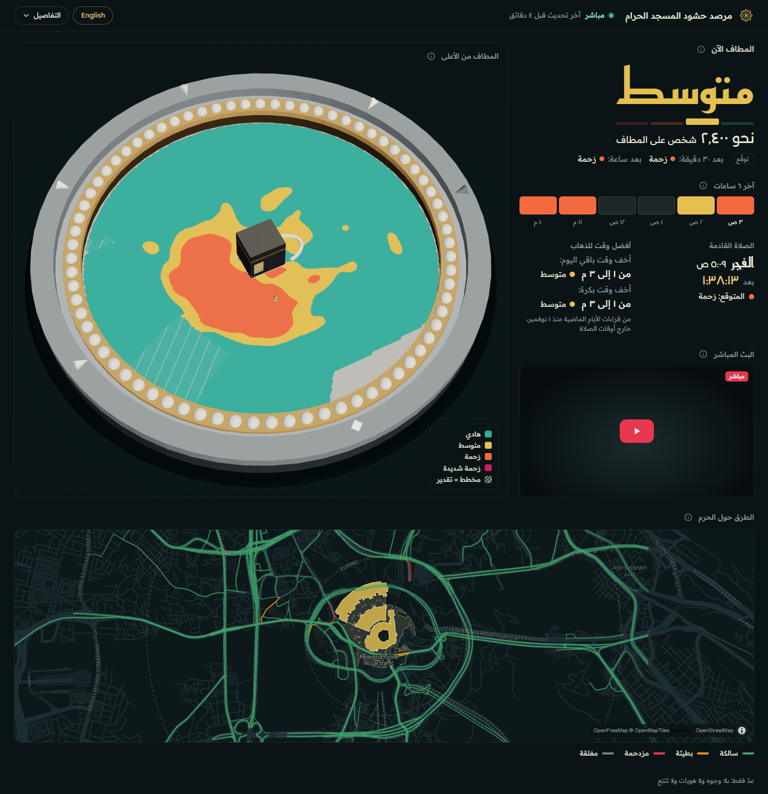
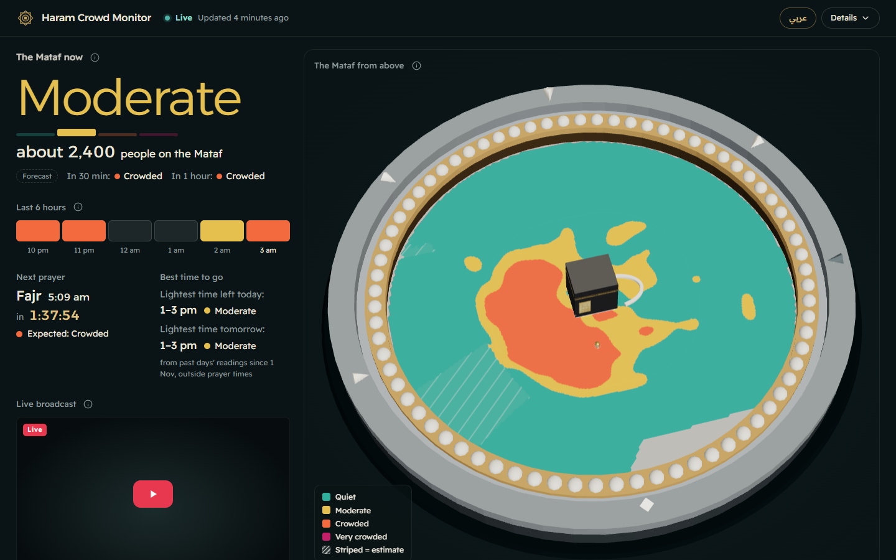
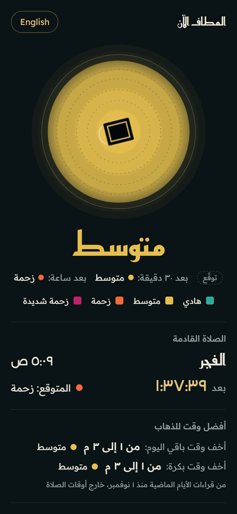
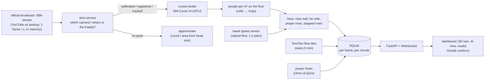
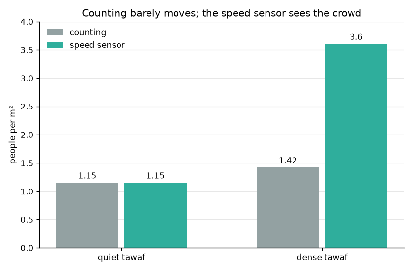

# Haram Crowd Monitor

**مرصد حشود المسجد الحرام** · A live crowd and road-traffic monitor for the Mataf, the courtyard around the Kaaba in
Masjid al-Haram, Makkah. Built from public data only: the official 24/7 broadcast (SBA's own stream, YouTube as
backup), TomTom traffic tiles and the Umm al-Qura prayer times. One laptop GPU, one PC, running since 2026-10-23.

**Why it matters:** the crowd around the Kaaba swells and empties with every prayer, and a visitor has no live answer
to "how crowded is it now, and when is it lighter?"; this reads it from the public broadcast alone.

## Key results

| What | Result |
|---|---|
| **Crowd density from a TV broadcast** | people per m² on the Mataf floor from the live broadcast, no on-site sensors |
| **Prayer rows, held-out prayers** | 1.02 of the labels (1,301 frames) |
| **Dense tawaf** | counting stays near 1.4; the speed sensor reads 3.6 |
| **Forecast, 15 / 30 / 60 min** | 23–25 % better than "same time yesterday" (1–6 Nov), better on every day |

**Tech stack:** PyTorch, OpenCV, LightGBM, FastAPI, SQLite, React/Vite, Three.js.


## What it does

- **Measures how dense the crowd is on the Mataf floor, in people per m²**, from the live broadcast, about one frame
  a second, whichever camera is on air. The reading is view-independent: the same crowd gives the same number from the
  low camera, the wide camera or the roof, at any zoom.
- **Gives it a meaning:** quiet (< 0.7 people/m²), busy (0.7–1.1), crowded (1.1–2.2), packed (> 2.2), per ring
  (inner 1–10 m from the Kaaba's walls, outer 10–25 m) and for the whole Mataf, with the trend and the usual level
  for that time of day.
- **Reads the roads** around the Haram from TomTom traffic-flow tiles every 5 minutes (within 1 and 3 km).
- **Shows it** on two pages, Arabic first with an English toggle. The main dashboard: the crowd now as one word and
  about how many people, the forecast for 30 minutes and 1 hour, the last 6 hours as hourly blocks, the next prayer
  with a countdown, the best time to go, the Mataf as a 3D twin in flat level colours with a colour key, the live
  broadcast and the road map; the engineer's view (cameras, people per m², the AI view, the prayer timeline, road
  numbers, alerts) sits behind "Details". `/simple`, a phone-first page for visitors: one word for the crowd now, the
  forecast for 30 minutes and 1 hour, the next prayer, the best time to go, a green / orange / red road map.
- **Forecasts the next hour:** LightGBM, 15 / 30 / 60 minutes ahead, from the time of day, the prayer schedule and the
  last readings, retrained every night at 03:00 Makkah on all readings. Both pages show one line, marked as a
  forecast: the level word and colour in 30 minutes and in 1 hour ("بعد ٣٠ دقيقة: زحمة   بعد ساعة: متوسط"). It went
  on the pages on 7 Nov, after beating "same time yesterday" on every day since 1 Nov.

Counting only. No face detection, no recognition, no tracking of anyone (see [Privacy](#privacy)).

| Main dashboard, Arabic (whole page) | Main dashboard, English | Visitor page `/simple` |
|---|---|---|
|  |  |  |

The visitor page as one still: [`docs/media/simple_ar.png`](docs/media/simple_ar.png). None of the media shows video
pixels: the player is not started and the twin is drawn from numbers.

## How it works



**Crowd model.** [DM-Count](https://github.com/cvlab-stonybrook/DM-Count), fine-tuned on this broadcast (v4: 7,482
frames labelled by prayer-row geometry, never by hand). It outputs a density map, ~0.1 s a frame on a laptop GPU.

**Kaaba calibration.** The Kaaba's known size gives each frame a camera pose, so every density cell gets a floor area
in m². Frames with no pose get a rough reading from head size, never drawn on the floor.

**Prayer rows.** Where the row pattern is found, the density comes from the row spacing (about 1.4 people/m²).

**Fixes.** Logged rules for the packed wall queue, the far side in prayer and stopped rows (at least 1.2 people/m²
where the speed sensor sees a still crowd).

**Tawaf speed sensor.** Optical flow on frames 1 s apart gives the tawaf speed per sector; a speed-density curve turns
slow walking into density, where counting sees no heads.



Quiet tawaf against dense tawaf (29 Oct, 18:46): counting goes from 1.15 to 1.42 people/m², the speed sensor from
1.15 to 3.6. The 1,457-point scatter behind it: [`docs/architecture.md`](docs/architecture.md).

**Twin and AI view.** A 3D Mataf with the floor in the four level colours, estimated floor striped. The AI view draws
the density over the building's outlines.

**Roads.** TomTom flow tiles every 5 minutes within 1 and 3 km, inside the free tier.

**Visitor page and best time.** No numbers: the crowd as a word, the forecast as words, the next prayer, the lightest
two hours left today and tomorrow (the median of each half hour since 1 Nov, outside prayer times), the roads.

**Forecast.** LightGBM on the change from the latest 5-minute reading, 15 / 30 / 60 minutes ahead, retrained every
night on all readings, newer days weighing more. The 30 and 60-minute models give the forecast line on both pages.

**Services.** A supervisor runs eight children (collector, shot service, traffic, API, LAN proxy, DVR, housekeeping,
forecast). Readings are kept forever, frames are not.

The long version: [`docs/architecture.md`](docs/architecture.md).

## How well it works

- **Rows labels, four held-out test windows** (two prayers held out of v4's training and two Fajr screen recordings,
  1,301 labelled frames; 1.00 = the label): the live model (v4 + the stopped-rows fix) reads 1.02, with 122 frames over
  1.2×; behind the Kaaba 1.07; close low-camera zooms 1.08. v4 alone: 1.00 / 1.05 / 0.96.
- **v5b, not deployed:** 1.05 overall (165 frames over 1.2×), 1.13 behind the Kaaba, 1.02 on close zooms. Better only
  on close zooms, so the live model stays v4 + the fix (the rule: better overall and on close zooms, no more
  overshoots, not worse behind the Kaaba).
- **Close low-camera zooms in prayer** (the hard case): per prayer, the live model reads 0.89–1.18 of the row labels.
  The fix helps where v4 under-reads and overshoots where v4 is already right.
- **Dense tawaf** (6–8 px heads): no count model reads it; the speed sensor does, against two reference points.
- **Forecast** (each day scored by the model trained on the days before, 5-minute bins): on 1–6 Nov MAE
  0.36 / 0.36 / 0.37 people/m² at 15 / 30 / 60 min, against 0.48 / 0.48 / 0.48 for "same time yesterday"
  (−24 / −25 / −23 %), better on each of the six days; on Friday 6 Nov −18 / −15 / −13 %. On 26–31 Oct 0.25 / 0.24 /
  0.27 against 0.31 / 0.28 / 0.33 (15 and 60 min from 27 Oct). The level word was right for 60 % of the bins at 30 min
  (same time yesterday: 50 %) and 58 % at 1 hour (52 %); on Friday at 1 hour 39 % against 48 %: near the busy /
  crowded line (1.1 people/m²) a small error changes the word.
- **The day on the Mataf** (1–3 Nov): crowded (1.1–2.2 people/m²) in every hour with readings except 11:00–14:00
  Makkah, which reads busy (about 0.9–1.1). In the half hour after the Fajr, Maghrib and Isha adhan the floor reads about
  1.2–1.3, against about 2 before and after: the prayer rows, when tawaf stops.
- **Data so far** (to 6 Nov, Makkah days): 8,857 minutes with a Mataf reading (since 24 Oct) and 3,805 TomTom polls
  (since 23 Oct). Uptime (minutes with broadcast frames per Makkah day, 24 Oct – 6 Nov): 74.2–99.9 %, median 90.9 %;
  the gaps are planned stops and restarts of the development PC.

## Limits, honestly

- **Only what the broadcast shows.** The director picks the camera. Most readings come from three calibrated cameras
  (a low camera near the Mataf, a wide one, the roof); the whole Mataf is rarely in one frame, and by day the
  calibrated cameras are on air less. A reading is the density of the part of the floor in view.
- **The model is trained on this broadcast's own geometry labels**, not on hand counts: the row labels come from the
  prayer-row pitch, the dense-tawaf scale from a speed curve with two points. Absolute numbers above ~2 people/m² are
  the least certain.
- **SBA's stream is 720p** (YouTube's is 1080p): the model finds fewer small, far heads on it, so SBA frames have
  their own head-size curve, fitted on simultaneous SBA / YouTube frames to keep both on the same level.
- **Camera poses from the Kaaba** are good to a few pixels; on long zooms a small pose error moves the rings by metres.
- **The speed sensor needs texture and 1 s pairs**; it does not read a stopped crowd (prayer, queues), and bowing in
  prayer looks like motion.
- **Fixes are rules**, each with a switch and a log line, chosen on small test sets (tens to hundreds of pairs). They
  can be wrong on a crowd they have not seen.
- **Thirteen full days of readings (25 Oct – 6 Nov), six of them since 1 Nov, one Friday among them:** the forecast
  and the best time to go are first estimates; the "usual for this time" needs weeks.
- **The 3D twin is schematic:** camera positions are solved, the building is traced from reference frames.

## Privacy

- **Counting only.** No face detection, no recognition, no re-identification, no tracking of individuals. The speed
  sensor measures the flow of texture, not people.
- **Frames stay on the PC.** A broadcast frame lives in memory for one pass. The only frames on disk are local
  samples for calibration and tests (`data/`, gitignored), never uploaded, never committed.
- **What leaves the PC:** numbers (densities, counts, timings), a small density heatmap (colours only) and the
  building's outlines. The dashboard plays the broadcast itself (the public YouTube player, or SBA's stream when
  YouTube is not available).
- **No scraping** of any official site; SBA's public stream is read as any viewer would, and YouTube, the backup, with
  at most one stream lookup a day.

## Run it

```bash
python -m venv .venv
.venv/Scripts/python -m pip install -r requirements.txt
cp .env.example .env                       # STREAM_URL, TOMTOM_API_KEY (the key lives only here)
npm --prefix dashboard install && npm --prefix dashboard run build
start.bat                                  # the supervisor and its children; stop.bat stops them
# dashboard: http://localhost:8000   visitor page: http://localhost:8000/simple   status: /api/status
```

More detail: [`docs/architecture.md`](docs/architecture.md) (how it works),
[`docs/track_b.md`](docs/track_b.md) (database, TomTom, prayer times).

## Credits and licences

DM-Count (MIT) by Wang et al. UCF-QNRF and HAJJv2-CrowdCount are research datasets. Map data © OpenStreetMap
contributors, tiles by OpenFreeMap / OpenMapTiles. Traffic flow © TomTom. Prayer times: Aladhan API (Umm al-Qura
method). Live broadcast: Saudi Broadcasting Authority (Quran TV), from SBA's own stream, YouTube as backup. Tawaf free-walking speed: Dridi 2015.
Fonts: Alexandria, Readex Pro, Reem Kufi (SIL Open Font License).

## Author

Ahmed Houari · GitHub [Ahmed-Houari](https://github.com/Ahmed-Houari) · LinkedIn: _(link to add)_
