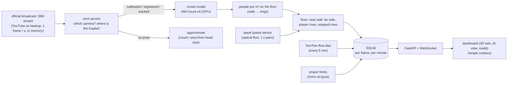
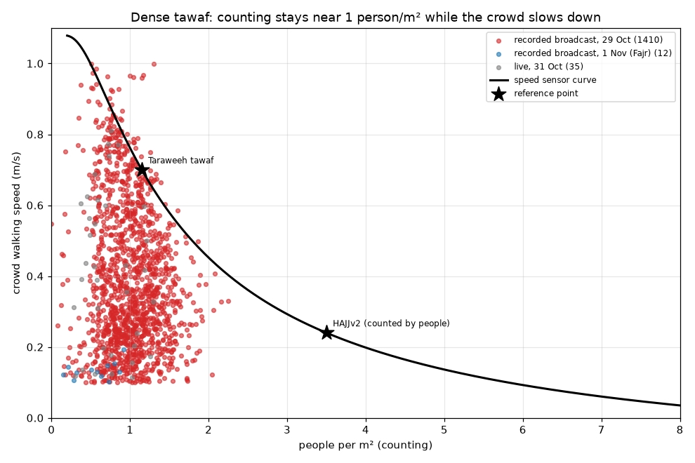

# How it works, in detail

The long version of the README's "How it works".

## Crowd model

[DM-Count](https://github.com/cvlab-stonybrook/DM-Count) (VGG-19 density map, UCF-QNRF weights), fine-tuned on this
broadcast ("v4": 7,482 frames from live and recorded prayers, labelled by the project's own prayer-row geometry, never
by hand). It outputs a density map: people per 8 × 8 px cell. FP16 on an RTX 5060 laptop GPU, ~0.1 s a frame. A
second fine-tune (v5b, 11,482 frames) was tested on 3 Nov and not deployed: better on close zooms, worse overall and
behind the Kaaba.

## Kaaba calibration (the metric)

Every frame on a known camera gets a camera pose (focal length, rotation, position) from the Kaaba itself: its box is
about 12 × 10 m with 14 m of black cloth, its corners are found in the frame and solved by PnP, checked against the
camera's known place. With the pose, every density cell is projected onto the floor plane and gets an area in m², so
the density map becomes people per m² per cell, summed into rings around the Kaaba (inner 1–10 m from its walls,
outer 10–25 m). The pose is found by one of three ways: *calibrated* (the Kaaba is fitted in the frame), *registered*
(the frame matched to a panorama bank of the camera's framings), *tracked* (frame-to-frame homography on a held
shot). Frames with no pose (close-ups, other cameras) get an *approximate* reading from head size, error about ×2,
never drawn on the floor.

## Prayer rows

During prayer the count model under-reads seated and bowing rows. The row pattern (its pitch, about 1.2 m along the
lines from the Kaaba) is measured in the frame; where rows are found, the density is their known spacing:
1 / (row pitch × person pitch), about 1.4 people/m².

## Fixes on the live map

Each one is logged every minute. Near the walls, the maximum of v4 and the previous model on a crop (v4 reads the
packed wall queue low). Directly behind the Kaaba during prayer, the near side's density when the far side reads under
0.8× of it. And the **stopped rows** fix: in a prayer window, where the speed sensor says the crowd stands still and
the model sees people, at least 1.2 people/m² (fitted on 31 Oct's saved 1 s pairs: close low-camera zooms went from
0.73 to 0.87 of the row labels, with 4 overshoots in 27 instead of 11 at 1.39).

## Tawaf speed sensor

Two frames 1 s apart (same camera, pose from the first): the camera's own motion is removed with a homography on the
static architecture, then dense optical flow on the floor gives the crowd's counter-clockwise speed per 15° sector
and ring, weighted by image texture so empty marble does not count. A speed-density curve (Weidmann form, 1.08 m/s
free walking, two fitted points: 0.70 m/s ≈ 1.15 and 0.24 m/s ≈ 3.5 people/m²) gives the density of walking
sectors; stopped sectors keep the count model's. It reads the dense tawaf that no count model sees heads in. Motion
only: nobody is detected or followed.

Why it is needed: on 1,457 walking sector points from close low-camera tawaf (2,031 pairs of frames 1 s apart), the
most accurate counting method (the original DM-Count, tiled 2×) reads about 1 person/m² at every speed (0.96 at
0.10–0.20 m/s, 1.09 at 0.40–0.50, 0.82 at 0.70–0.85; correlation with speed −0.13): the low camera hides the heads,
so counting does not see the crowd get denser as tawaf slows. A curve fitted to those points runs to its bound and
would read slow tawaf near 1/m², so the two-point curve stays.

## Twin and AI view

The dashboard draws the Mataf as a 3D model with the floor in the four level colours (quiet < 0.7, busy 0.7–1.1,
crowded 1.1–2.2, packed > 2.2 people/m²), the hidden floor behind the Kaaba estimated from its neighbouring sectors
and striped as such, with a colour key in plain words. The AI view (behind "Details") shows the density map over the
outlines of the building, in the same colours.

## Roads

TomTom vector flow tiles (4 tiles cover 3 km) every 5 minutes, about 1,150 requests a day inside the free tier; mean
congestion level and the share of congested segments within 1 and 3 km. The map draws them green / orange / red,
closed roads grey; the pedestrian squares around the mosque have no car data.

## Visitor page and best time

`/simple`: Arabic first, English toggle, no numbers: the crowd now as one word and colour, the next prayer and its
expected crowd, the lightest two hours left today and tomorrow, the roads as green / orange / red, and when it was
updated. The best time is the median of each half hour over past days since 1 Nov (when the speed sensor changed the
levels; a half hour needs 2 days), a two-hour window the mean of its four, starting on the hour or the half hour,
skipping any window that overlaps a prayer (adhan to adhan + 30 min: the prayer rows, when tawaf stops). When even
the lightest window is crowded, the page says "the Mataf is crowded most of the day". The main dashboard shows the
same next prayer and best time.

## Forecast

LightGBM on the change from now, 15 / 30 / 60 minutes ahead, from the time of day, the prayer schedule and the last
readings; retrained every night at 03:00 Makkah on all readings (newer days weigh more), each day scored by the model
trained on the days before, against "same time yesterday" and "same as now". Not on the dashboard yet.

## Services

A Windows scheduled task runs a supervisor with eight children: the crowd collector (per-camera series, stream URL),
the shot service (the metric, the fixes, the speed sensor), the traffic / prayer-time collector, the API, a LAN proxy,
a DVR grabber (frames around every prayer, kept 2 days), housekeeping and the nightly forecast. Readings stay in the
database forever; frames do not. `start.bat` / `stop.bat` start and stop everything.
